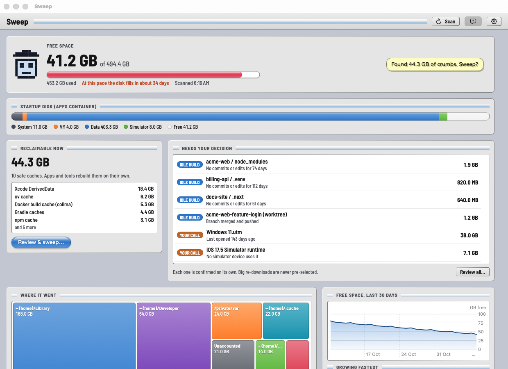
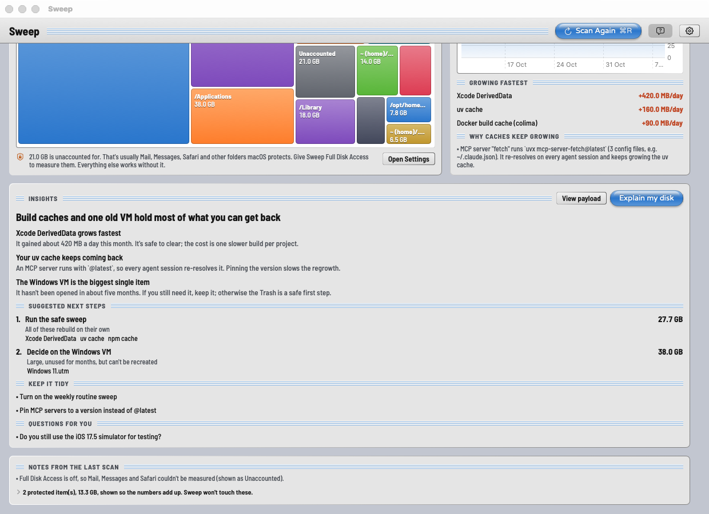
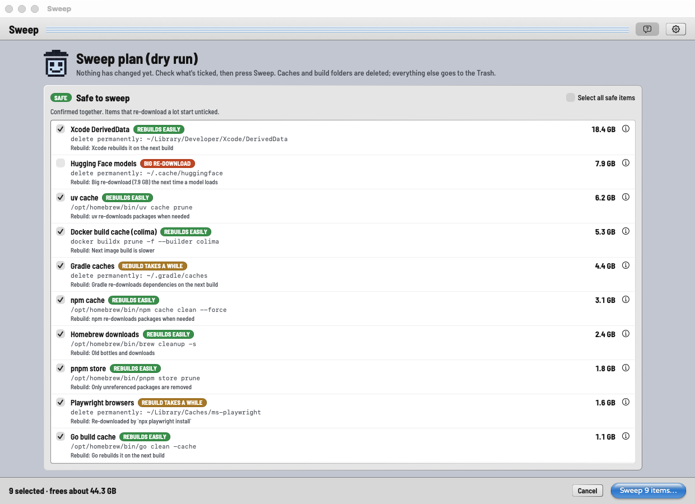
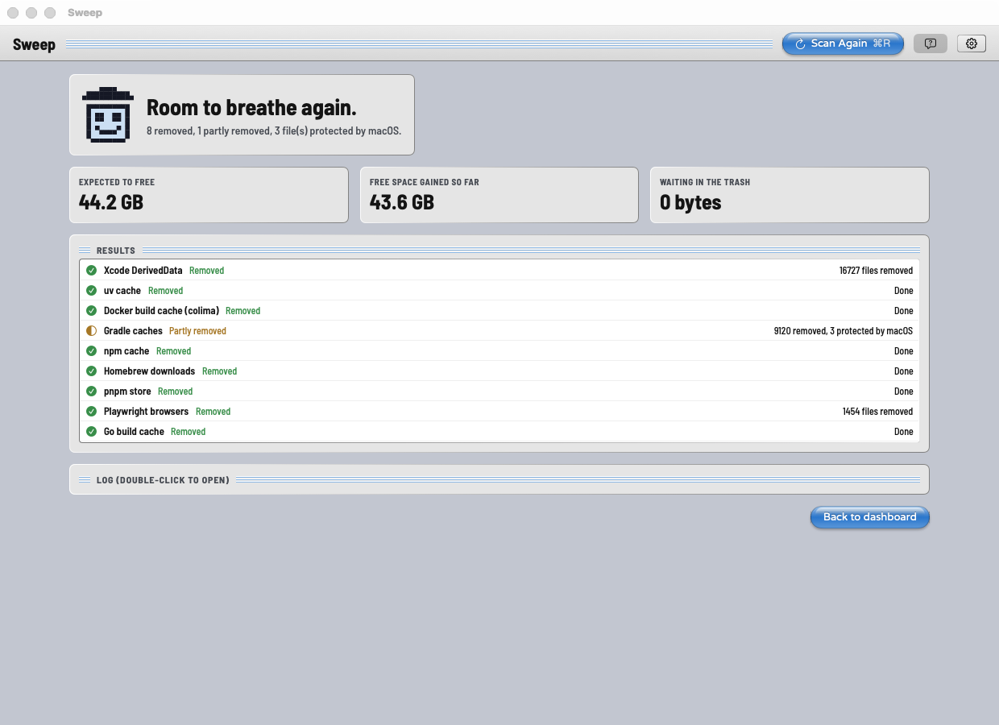
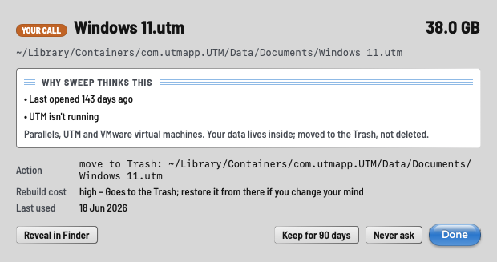
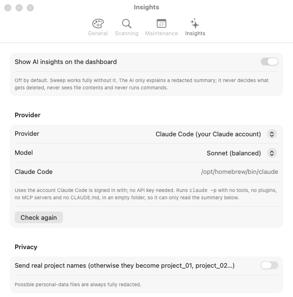
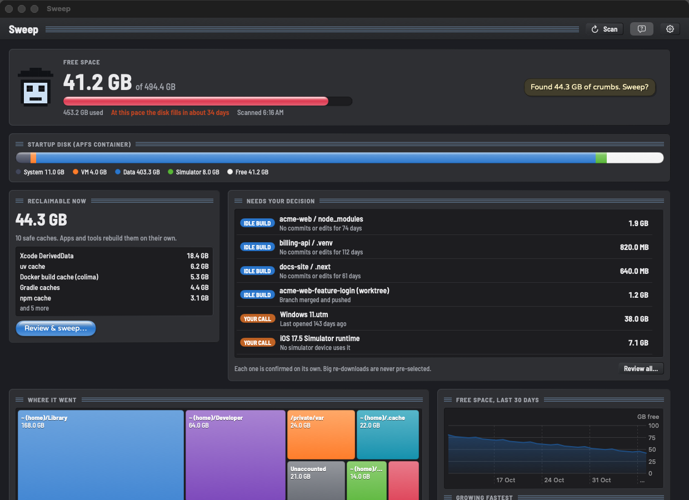
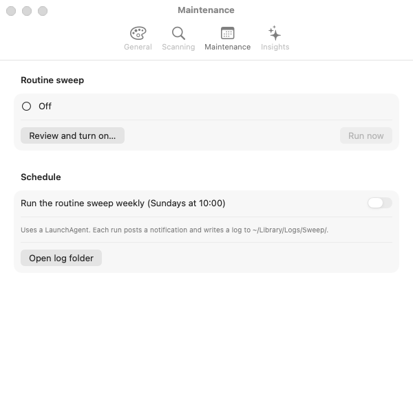

# Sweep

**Find where your Mac's disk space went, understand why, and get it back safely.**

Sweep is a native macOS app for developers. It looks in the places that fill up a developer's Mac: build caches, `node_modules`, Docker, simulators, old SDKs, VMs, AI model caches and leftovers from deleted apps. It measures them properly, explains each one in plain language and removes only what you confirm. Every step has a dry run first and a check afterwards.

The look is Mac OS 8 "Platinum" with iMac-era candy buttons ("Gumdrop Platinum"). It has six fruit flavours and a pixel trash-can mascot.



> Screenshots use made-up demo data (`SWEEP_DEMO=1`), not a real disk.

- **Deterministic code does everything that touches your disk.** Scanning, measuring, classifying and deleting are tested Swift code. No AI is involved in any of it.
- **AI is optional, and it only explains.** If you turn it on, an AI reads a *redacted* summary of the finished scan and explains it. It can't delete anything, run commands or read files. You choose the AI: **Claude Code** (your Claude account), **Ollama** (a local model; nothing leaves your Mac unless you pick one of Ollama's `-cloud` models) or the **Anthropic API**.
- **Safety is checked twice.** Every item is checked again just before it's acted on, not only at scan time.

---

## Contents

- [What it finds](#what-it-finds)
- [Screenshots](#screenshots)
- [Install](#install)
- [First run and permissions](#first-run-and-permissions)
- [How Sweep decides what's safe](#how-sweep-decides-whats-safe)
- [What Sweep never touches](#what-sweep-never-touches)
- [Routine sweeps (menu bar and weekly)](#routine-sweeps-menu-bar-and-weekly)
- [AI insights](#ai-insights)
- [Command line](#command-line)
- [Data Sweep keeps](#data-sweep-keeps)
- [Documentation](#documentation)
- [Status](#status)
- [License](#license)

## What it finds

| Kind | Examples | What Sweep does |
|---|---|---|
| **Safe caches** | Xcode DerivedData, uv, npm, pnpm, bun, pip, Homebrew, Go, Cargo, Gradle, Playwright/Puppeteer browsers, Hugging Face and Torch caches, Docker build cache | Uses the tool's own cleanup command where one exists (`uv cache prune`, `brew cleanup -s`, `docker buildx prune --builder …`); otherwise deletes the cache folder |
| **Idle build artifacts** | `node_modules`, `.venv`, `target`, `.next`, `dist`, `.turbo`, `__pycache__` inside projects you haven't touched for a while; finished git worktrees | Checks git (no uncommitted changes, no unpushed commits) and running processes first; asks you about each one |
| **Your call** | VMs (UTM, Parallels, VMware), iOS simulator runtimes, old Xcode device support, Ollama / LM Studio models, conda envs, TeX Live, large files, old installers, unused Docker images | Explains what it is and when it was last used, and asks about each one. Files and folders go to the Trash. Simulator runtimes, Ollama models and Docker images are removed by their own tool (`xcrun simctl`, `ollama rm`, `docker image rm`), which is permanent; the plan says so before you confirm |
| **Leftovers** | Support files of apps you dragged to the Trash | Matches by bundle id or app name and moves them to the Trash; admin-owned files are only revealed in Finder |
| **Protected** | APFS clones, SIP-protected files, iCloud placeholders, cloud-synced folders | Listed so the totals add up; never touched |

It also explains **why caches keep coming back**. For example, an MCP server configured with `uvx something@latest` re-resolves on every agent session. Sweep also shows the free-space trend and which items grow fastest.

## Screenshots

| | |
|---|---|
|  **Dashboard.** Free space, the APFS container, what's reclaimable now and what needs your decision. |  **Where it went.** Treemap of folders, the 30-day trend, the fastest growers, why caches regrow and the AI's explanation. |
|  **Dry run.** Every path, size, rebuild cost and the exact command. Nothing has changed yet. |  **After the sweep.** Expected vs. actual space freed, per item, including what macOS protected. |
|  **Why Sweep thinks this.** The evidence behind each item, with Keep for 90 days / Never ask. |  **Choose your AI.** Claude Code, Ollama or the Anthropic API. |
|  **Graphite (dark mode).** |  **Routine sweeps** are off until you read and approve the list. |

## Install

### Download a release

1. Download `Sweep-<version>.dmg` (or `.zip`) from [Releases](https://github.com/halalgami/sweep/releases). It needs macOS 14 or later on Apple Silicon.
2. Open the DMG and drag **Sweep** onto **Applications**.
3. Open Sweep. The first time, macOS says it "cannot verify" Sweep, because releases are **not notarized** by Apple yet. If you trust this download, go to **System Settings → Privacy & Security**, scroll down and click **Open Anyway**. Or, in Terminal:
   ```bash
   xattr -dr com.apple.quarantine /Applications/Sweep.app
   ```

You can check the download against `SHA256SUMS.txt` on the release page (`shasum -a 256 Sweep-*.dmg`). Releases are ad-hoc signed, so macOS may ask again for Full Disk Access and Finder automation after you install a new version.

### Build from source

**Requirements:** macOS 14 or later on Apple Silicon, Xcode 26 or later (Swift 6), and [XcodeGen](https://github.com/yonaskolb/XcodeGen) (`brew install xcodegen`).

```bash
git clone https://github.com/halalgami/sweep.git
cd sweep
scripts/install.sh        # builds Release and copies it to /Applications/Sweep.app
open -a Sweep
```

The build uses ad-hoc signing ("Sign to Run Locally") by default, so you don't need an Apple Developer account. macOS remembers privacy permissions per signature, though, so ad-hoc builds may ask again after each rebuild. To sign with your own team, create `App/Local.xcconfig`:

```
DEVELOPMENT_TEAM = ABCDE12345
CODE_SIGN_IDENTITY = Apple Development
```

To work on it in Xcode instead, run `cd App && xcodegen generate && open Sweep.xcodeproj` and press Run.

## First run and permissions

Sweep starts a read-only scan when it opens. Scanning never changes anything.

| Permission | Needed for | Without it |
|---|---|---|
| Documents / Desktop / Downloads (asked on first scan) | Idle projects, large files, old installers | Those folders are skipped, and the scan notes say so |
| **Automation → Finder** (asked when needed) | Listing the Trash to find leftovers of deleted apps; emptying the Trash when you press the button | Leftover detection is skipped with a note |
| **Full Disk Access** (optional) | Measuring Mail, Messages, Safari and other folders macOS protects | Everything else still works. The gap shows as **Unaccounted**, with a button to open System Settings |
| Notifications | Low-space and growth alerts, routine sweep summaries | No alerts |

## How Sweep decides what's safe

1. **Scan** (read-only). Measures *physical* size: allocated blocks, each hard link counted once, cloud placeholders as 0, never crossing into another volume. Each place is checked by a rule from [`rules.json`](Sources/SweepCore/Resources/rules.json).
2. **Plan** (a dry run). Every item shows its path, size, risk tier, rebuild cost and the exact command or action. Safe caches are confirmed together. Idle build folders and "your call" items are ticked one at a time and never pre-selected. Big re-downloads (AI model caches, for example) start unticked.
3. **Execute.** Just before acting, `SafetyGuard` checks each item again. It is skipped if:
   - the path became a symlink;
   - the project was touched since the scan;
   - the app it belongs to is running;
   - the worktree has uncommitted changes;
   - the command isn't on the allow list.

   Caches and build folders are deleted. Everything else goes to the **Trash**. No shell is used anywhere. Results are reported per path, for example "12 removed, 3 protected by macOS".
4. **Verify.** Sweep measures free space again and shows expected vs. actual. APFS often frees space a little later, so it measures once more after 60 seconds.

Details: [docs/SAFETY.md](docs/SAFETY.md).

## What Sweep never touches

- Running Docker containers and Docker volumes. Docker commands are on a strict allow list, and Sweep never starts Docker itself.
- iCloud Drive, Dropbox, OneDrive, Google Drive and Box folders. Also your Desktop and Documents when they sync to iCloud.
- Keychains, Mail, Messages, Safari, Photos, Notes data and system folders: `/System`, `/usr` (except `/usr/local`), `/bin`, `/sbin`, `/private/etc` and `/Library/Apple`.
- Projects that became active since the scan, git worktrees with uncommitted changes, unpushed commits or no upstream, and anything a running process is using.
- Anything inside a folder on your **protected** list (Settings → Scanning).
- Admin-owned leftovers (`/Library/LaunchDaemons`, `PrivilegedHelperTools`, package receipts). These are only revealed in Finder; receipts come with the exact `sudo pkgutil --forget <id>` command for you to run yourself.

## Routine sweeps (menu bar and weekly)

One-click and scheduled sweeps run **only** the routine list:

- `uv cache prune`
- `npm cache clean --force`
- `brew cleanup -s`
- `pnpm store prune`
- `go clean -cache`
- Xcode DerivedData
- Docker build cache, pruned per builder name

Routine sweeps are off until you open **Settings → Maintenance → Review and turn on…**, read the list and tick "I understand what this removes".

- The menu bar shows what will run before you press the button.
- Every run posts a notification and writes a per-path log to `~/Library/Logs/Sweep/`.
- If the routine list changes (after a rules update, for example), routine sweeps pause until you approve the new list.

The weekly schedule is a LaunchAgent (`~/Library/LaunchAgents/dev.algamthe.sweep.agent.plist`) that runs `Sweep.app/Contents/MacOS/SweepAgent`.

## AI insights

Insights are off by default (Settings → Insights). Sweep works fully without them.

| Provider | Account | Where the summary goes | Notes |
|---|---|---|---|
| **Claude Code** (default) | The account the `claude` CLI is signed in with; no API key | Anthropic | Runs `claude -p` with **no tools**, `--safe-mode` (no CLAUDE.md, hooks, plugins or MCP servers), no saved session, in an empty folder. Models: Sonnet, Opus, Haiku |
| **Ollama** | None | **Stays on your Mac** (`127.0.0.1:11434`), except Ollama's `-cloud` models, which run on Ollama's servers | Lists your installed models. 14B or larger gives noticeably better answers than 8B |
| **Anthropic API** | API key, stored in the Keychain | Anthropic | Messages API with structured output, default `claude-sonnet-5-5` |

Sweep's code builds the summary, and you can read it with **View payload** before the first request:

- Bucket totals and the 40 largest items: ids, categories, sizes, tiers, rebuild cost, days since last use.
- Growth rates, root-cause hints, and how often you declined each item.
- Your username becomes `~`; other users become `/Users/<user>`.
- Under Documents, Desktop, Downloads and your project folders, project and file names become `project_01`, `file.csv` and so on, unless you opt in to real names.
- Files that may hold personal data are always fully redacted. File contents are never read.

The answer must match a strict JSON schema, and item ids are limited to the ids in your scan. Any answer that mentions an unknown id is thrown away. Sizes shown next to suggestions are computed by Sweep, never taken from the AI. If the call fails, the rest of the app keeps working.

Details: [docs/INSIGHTS.md](docs/INSIGHTS.md).

## Command line

The `sweep` CLI uses the same core library as the app. Every command is read-only except `run --routine --yes`.

```bash
swift run sweep scan                       # human summary
swift run sweep scan --json                # full report as JSON
swift run sweep plan [--routine] [--json]  # dry run
swift run sweep run --routine --yes        # routine sweep; needs consent given in the app
swift run sweep rules --validate FILE      # check a rules override file
swift run sweep insights --payload         # print the redacted summary an AI would see
swift run sweep insights --provider claude-code|ollama|anthropic [--model NAME]
```

Add or change rules without rebuilding: create `~/Library/Application Support/Sweep/rules.json`. See [docs/RULES.md](docs/RULES.md).

## Data Sweep keeps

- `~/Library/Application Support/Sweep/history.db`: per-scan item sizes (for growth rates), your keep / never-ask decisions and run results.
- `~/Library/Logs/Sweep/`: per-run logs.
- Preferences in the `dev.algamthe.sweep` defaults domain. The Anthropic API key, if you use one, is in the Keychain.

## Documentation

| For | Read |
|---|---|
| Anyone changing the code (human or AI agent) | [AGENTS.md](AGENTS.md): commands, map, invariants, gotchas |
| How it fits together | [docs/ARCHITECTURE.md](docs/ARCHITECTURE.md) |
| The safety model and its tests | [docs/SAFETY.md](docs/SAFETY.md) |
| AI providers, redaction, output contract | [docs/INSIGHTS.md](docs/INSIGHTS.md) |
| Writing and overriding rules | [docs/RULES.md](docs/RULES.md) |
| Contributing | [CONTRIBUTING.md](CONTRIBUTING.md) |
| Original design and plan | [docs/superpowers/specs](docs/superpowers/specs), [docs/superpowers/plans](docs/superpowers/plans) |
| What changed | [CHANGELOG.md](CHANGELOG.md) |

## Status

Version 0.3.1. It works day to day on the author's Mac. Known gaps:

- Not yet Developer ID signed or notarized: releases are ad-hoc signed, so macOS warns on first launch (see [Install](#install)).
- Apple Silicon only.
- No automatic updates.
- Sweep is deliberately outside the Mac App Store, because the sandbox would stop it from doing its job.

## License

[MIT](LICENSE) © 2026 halalgami ([me@algamthe.dev](mailto:me@algamthe.dev)).
Fonts: Barlow Semi Condensed and Varela Round, both under the SIL Open Font License.
